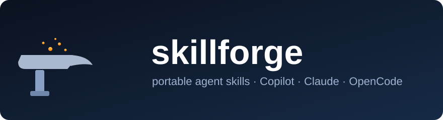

<p align="center">
  
</p>

<p align="center">
  <a href="LICENSE"></a>
  
  
</p>

# skillforge

A collection of portable agent skills for Copilot, Claude, and OpenCode. Each
skill is a folder of plain Markdown plus a few scripts, so the same skill runs on
any of the three platforms with no rewrite.

Everything here is generic. The repo carries no company, product, host, path,
secret, or ticket data, and a leak scanner enforces that on every commit and in
CI. See [CONTRIBUTING.md](CONTRIBUTING.md).

## Skill catalog

| Skill | Solves | Docs |
| ----- | ------ | ---- |
| [rca-tracer](skills/rca-tracer/) | Root-cause analysis across one or many repositories. Traces a symptom to a cited `file:line` and names the layer to fix, without guessing. Reads code remotely from any Git host (GitHub, GitLab, Bitbucket) with a read-level token, no clone needed, or from a local checkout when present. | [README](skills/rca-tracer/README.md) · [SKILL](skills/rca-tracer/SKILL.md) |
| [pr-responder](skills/pr-responder/) | Review pull requests and answer review comments in a human voice, with no AI tells. Reads the cited code, drafts a reply or a review, and runs every post through two gates: a grounding gate (rejects a draft that cites a file or commit the PR does not contain) and a humanize gate (strips generated punctuation, then lints with slophound) so nothing goes out sounding like a bot or pointing at made-up code. Works on GitHub, GitLab, and Bitbucket. | [README](skills/pr-responder/README.md) · [SKILL](skills/pr-responder/SKILL.md) |

More skills will land in `skills/`. Each one keeps the same shape, so the install
steps below cover all of them.

## Install

Pick your platform once. After that, invoking any skill is the same.

### GitHub Copilot

Copy a skill folder into your Copilot skills directory:

```bash
cp -r skills/rca-tracer ~/.copilot/skills/
```

Copilot reads the YAML frontmatter in `SKILL.md` and offers the skill when a
request matches its `description`. Full notes: [adapters/copilot.md](adapters/copilot.md).

### Claude (Claude Code / claude.ai skills)

```bash
cp -r skills/rca-tracer ~/.claude/skills/
```

Claude reads the same `SKILL.md` frontmatter. Full notes:
[adapters/claude.md](adapters/claude.md).

### OpenCode

OpenCode loads skills from its config directory. Copy the folder and reference it
as a command or agent. Full notes: [adapters/opencode.md](adapters/opencode.md).

```bash
cp -r skills/rca-tracer ~/.config/opencode/skills/
```

> Install formats change over time. Each adapter file records the format that was
> confirmed against the platform docs, with the date, so you can re-check before
> you rely on it.

## Repository layout

```
skillforge/
  README.md                  this file: catalog + install
  LICENSE                    MIT
  CONTRIBUTING.md            rule #1: no internal data
  docs/
    images/banner.svg
  adapters/
    copilot.md  claude.md  opencode.md
  skills/
    <name>/
      SKILL.md               frontmatter + the method
      README.md              short "what it solves" + setup/usage
      references/            templates and deep-dives, loaded on demand
      examples/              fully fictional worked examples
  scripts/
    leak_scan.py             repo-wide private-data scanner
    verify.py                one-command gate (leak scan + frontmatter + tests)
    new_skill.py             scaffold a new skill folder
  tests/
    test_leak_scan.py
  .githooks/
    pre-commit                 leak scan before every commit
    pre-push                   full gate before every push
  .github/workflows/validate.yml
```

## Verify before you push

```bash
python scripts/verify.py
```

That runs the leak scan, checks every skill's frontmatter, and runs the unit
tests. CI runs the same gate on every push and pull request.

To catch problems even earlier, enable the git hooks once per clone:

```bash
git config core.hooksPath .githooks
```

The `pre-commit` hook runs the leak scan, and `pre-push` runs the full gate, so
private data or a broken gate cannot leave your machine. See
[.githooks/README.md](.githooks/README.md).

## Add a skill

```bash
python scripts/new_skill.py my-skill "One line on what it solves."
```

Edit the generated `SKILL.md`, keep the examples fictional, and run
`python scripts/verify.py` until it passes. Details in
[CONTRIBUTING.md](CONTRIBUTING.md).

## License

MIT. See [LICENSE](LICENSE).
